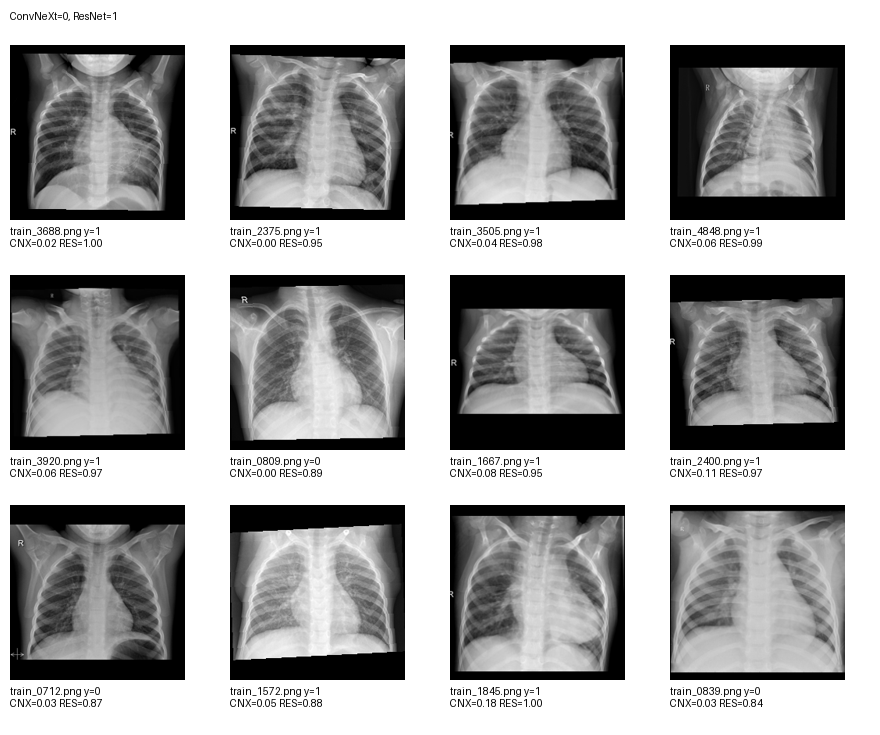
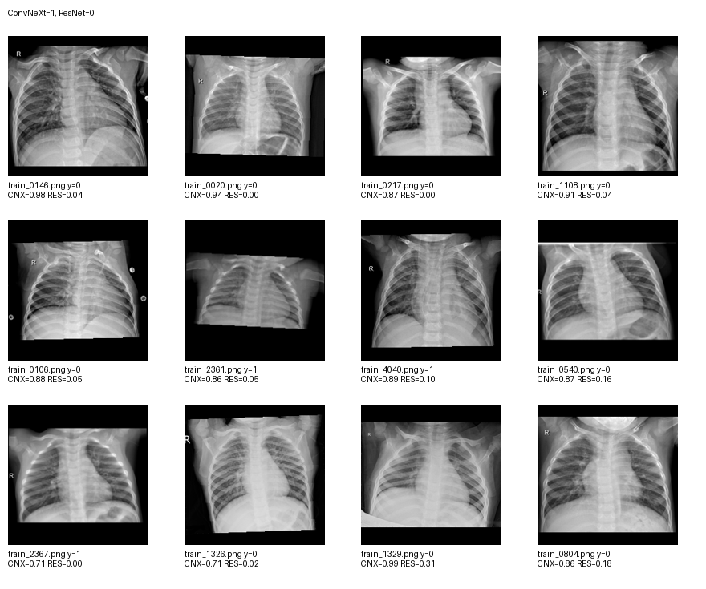

# EXP-93 ConvNeXt vs ResNet 판단 방향 차이 분석

## 결론

ConvNeXt와 ResNet의 판단 방향 차이는 밝기, 대비, 경계 강도 같은 단순 영상 통계만으로는 설명되지 않았다. 두 모델이 서로 다른 공간적 패턴과 표현을 사용하는 것이 더 유력하다.

## 핵심 수치

- 전체 OOF 샘플: 5,216
- 모델 판단 불일치: 126
- ConvNeXt=0, ResNet=1: 90
- ConvNeXt=1, ResNet=0: 36
- 영상 통계 기반 방향 분류 balanced accuracy: 0.514

`0.514`는 거의 우연 수준이므로 평균 밝기, 대비, entropy, gradient, 중앙/주변 명암만으로 어느 모델이 1을 예측할지 안정적으로 구분할 수 없었다.

## 오류 방향

| 그룹 | 샘플 수 | 실제 양성 비율 | ConvNeXt 정확도 | ResNet 정확도 |
|---|---:|---:|---:|---:|
| ConvNeXt=0, ResNet=1 | 90 | 0.711 | 0.289 | 0.711 |
| ConvNeXt=1, ResNet=0 | 36 | 0.500 | 0.500 | 0.500 |

ResNet이 1, ConvNeXt가 0인 그룹에서는 실제 양성이 71.1%였고 ResNet이 더 자주 맞았다. 이는 전체 OOF에서 ResNet의 FN이 40개, ConvNeXt의 FN이 86개였던 결과와 일치한다.

## 대표 이미지

### ConvNeXt=0, ResNet=1

### ConvNeXt=1, ResNet=0

## 해석 한계

- 영상 통계와 예측 방향의 연관성을 본 것이며 인과관계를 증명한 것은 아니다.
- 몽타주만으로 모델이 실제 병변을 보았다고 단정할 수 없다.
- 다음 단계에서는 같은 disagreement cohort에 fold별 Grad-CAM을 적용해 두 모델의 반응 위치 차이를 확인할 수 있다.
