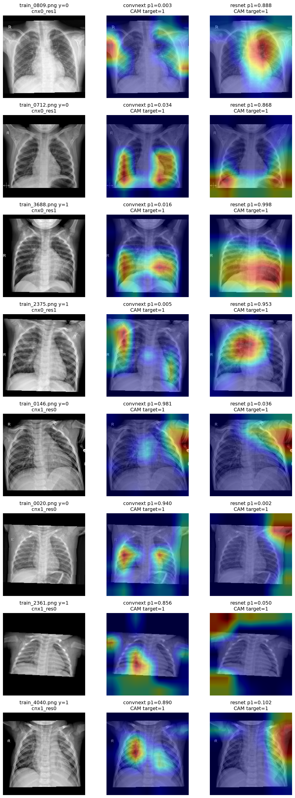

# EXP-94 OOF disagreement Grad-CAM 비교

## 결론

ConvNeXt와 ResNet은 동일한 OOF disagreement 이미지에서 class 1 근거를 서로 다른 위치에 두는 경향을 보였다.

- CAM pixel correlation 평균: 0.251
- CAM 상위 20% 영역 IoU 평균: 0.216

두 값이 모두 낮아 두 모델의 양성 반응 위치가 상당히 다르다는 신호다.

## 방향별 결과

### ConvNeXt=0, ResNet=1

- ResNet 중앙 영역 CAM 비중: 0.379
- ConvNeXt 중앙 영역 CAM 비중: 0.272
- ResNet이 양성을 예측할 때 중앙 폐야 주변 반응이 상대적으로 컸다.

### ConvNeXt=1, ResNet=0

- ConvNeXt 중앙 영역 CAM 비중: 0.367
- ResNet 중앙 영역 CAM 비중: 0.070
- ResNet class-1 CAM은 상단 비중 0.754로 바깥/상단에 치우쳤다.

## 시각화

## 주의점

- 두 모델 모두 class 1을 target으로 CAM을 계산했다.
- 모델이 class 1 확률을 매우 낮게 준 경우 해당 class CAM은 약하거나 불안정할 수 있다.
- CAM은 모델 반응 위치를 보여줄 뿐 실제 병변 위치나 임상적 근거를 증명하지 않는다.
- 8개 대표 샘플 결과이므로 전체 disagreement에 대한 확정적 결론은 아니다.
