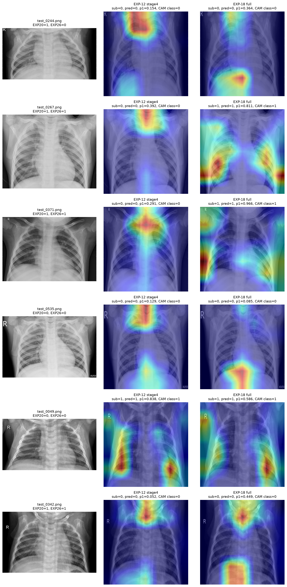
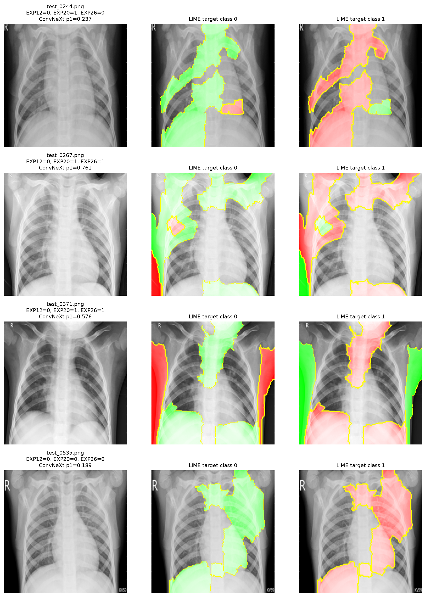
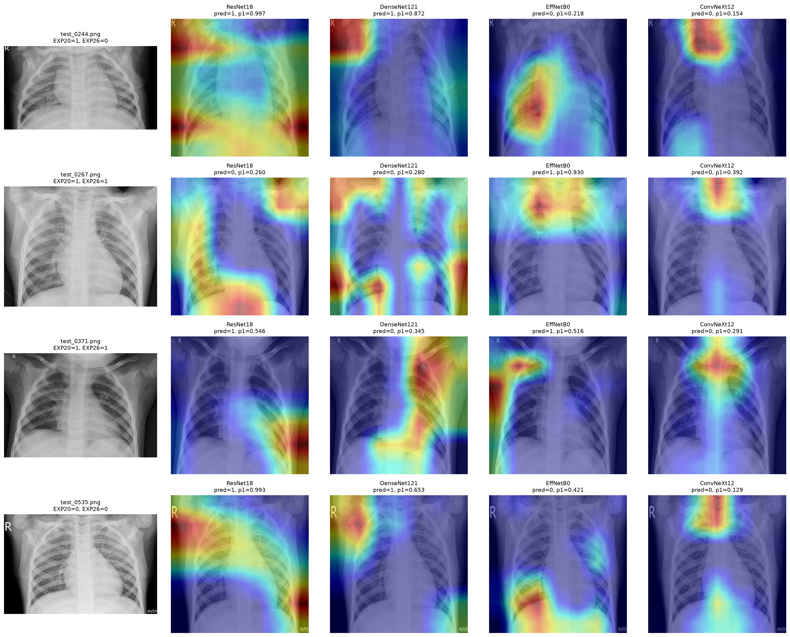
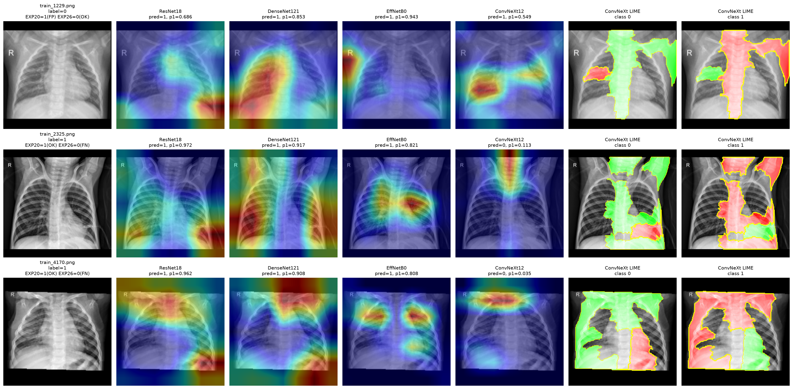
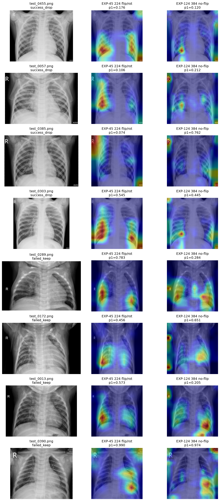

# 흉부 X-ray 이미지 분류 해커톤 최종 보고서

작성자: 오성민  
최종 제출일: 2026년 7월 1일  
최종 공개 리더보드: **0.9663461538 / 6위**

## 요약

이번 과제는 흉부 X-ray 이미지를 정상과 폐렴으로 분류하는 이진 분류 문제였다. 처음에는 baseline CNN을 개선하고 pretrained CNN을 적용하는 방향으로 출발했지만, 대회가 진행될수록 단순히 더 큰 모델을 쓰는 것보다 **검증 방식, 오류 양상, 모델 간 시각적 근거 차이**를 함께 관리하는 것이 중요하다는 점을 확인했다.

최종 접근은 `문제 정의 -> 전이학습 -> 다양한 backbone 비교 -> OOF 기반 검증 -> 모델 해석 -> 최종 제출 관리`의 흐름으로 발전했다. 성능 자체는 공개 리더보드 기준 0.9663461538까지 올랐고, 최종 순위는 6위였다. 다만 이 보고서에서는 단순 점수 상승보다, 어떤 가설을 세우고 실패를 통해 어떻게 다음 전략을 선택했는지를 중심으로 정리한다.

## 1. 문제 정의

### Baseline 성능

제공된 학습 데이터는 총 5,216장이었고, 테스트 이미지는 624장이었다. 학습 데이터의 클래스 분포는 다음과 같았다.

| label | 개수 | 비율 |
|---:|---:|---:|
| 0 | 1,341 | 25.71% |
| 1 | 3,875 | 74.29% |

초기 개선 SimpleCNN은 validation accuracy 0.97318까지 도달했지만, 공개 리더보드에서는 0.81891에 머물렀다. validation 성능만 보면 충분히 좋아 보였지만, 실제 제출 결과는 모델이 테스트 분포에 안정적으로 일반화하지 못하고 있음을 보여주었다.

### 문제점 1: Accuracy만으로는 의료 이미지 분류를 충분히 설명하기 어렵다

공식 평가는 accuracy였지만, 의료 이미지에서는 단순 정확도만으로 모델을 판단하기 어렵다. 특히 폐렴을 정상으로 분류하는 FN은 실제 서비스 관점에서 더 위험할 수 있고, 정상 이미지를 폐렴으로 분류하는 FP는 불필요한 추가 검사를 유발할 수 있다. 그래서 실험 과정에서는 accuracy뿐 아니라 precision, recall, F1, confusion matrix를 함께 확인했다.

### 문제점 2: 클래스 불균형과 validation-public gap이 동시에 존재했다

label 1이 약 74%였기 때문에 모델이 다수 클래스로 치우쳐도 accuracy가 높게 보일 수 있었다. 또한 초반 실험에서 validation은 높지만 리더보드가 낮은 결과가 반복되면서, 단일 validation split만으로는 모델의 일반화 성능을 안정적으로 판단하기 어렵다는 문제를 확인했다.

### 문제점 3: X-ray 특성상 augmentation이 항상 이득이 아니었다

일반 이미지 분류에서는 좌우 반전, 회전, crop이 자주 쓰이지만, 흉부 X-ray에서는 좌우 방향, 촬영 위치, 가장자리 표식 등이 모델 판단에 영향을 줄 수 있다. 따라서 augmentation은 무조건 많이 넣는 것이 아니라, 의료 이미지의 구조와 충돌하지 않는지 확인해야 했다.

**Mission 1 인사이트:** 의료 이미지 분류에서는 높은 validation accuracy보다, 클래스 불균형과 FN/FP의 의미를 함께 고려한 검증 구조가 먼저 필요하다.

## 2. 개선 전략

### 전략 1: Pretrained CNN fine-tuning

SimpleCNN의 한계를 확인한 뒤 pretrained CNN을 적용했다. ResNet18, DenseNet121, EfficientNet-B0, ConvNeXt-Tiny를 순차적으로 실험했다. 작은 데이터셋에서 처음부터 CNN을 학습하면 X-ray의 미세한 질감과 국소 패턴을 충분히 학습하기 어렵기 때문에, ImageNet 기반 사전학습 가중치를 활용해 일반적인 edge, texture, shape 표현을 가져오는 것이 더 현실적이라고 판단했다.

ResNet18은 첫 전이학습 모델로 적합했다. 구조가 비교적 단순하고 학습 안정성이 높아 baseline 이후의 개선 폭을 확인하기 좋았다. 이후 DenseNet121은 feature reuse 특성, EfficientNet-B0는 파라미터 효율성, ConvNeXt-Tiny는 최신 CNN 구조의 표현력을 기대하고 추가했다.

### 전략 2: Class weight와 오류 지표 중심 검증

학습 데이터가 label 1에 치우쳐 있었기 때문에 class weight를 적용했다. 단순 accuracy만 높이는 방향이 아니라, 소수 클래스에 대한 오류를 줄이고 confusion matrix를 통해 어떤 종류의 오분류가 발생하는지 확인했다.

예를 들어 ResNet18 초기 모델에서는 validation 기준 accuracy 0.9732, precision 0.982, recall 0.982, F1 0.982가 나왔고 confusion matrix는 `[[254, 14], [14, 762]]`였다. 이 결과는 모델이 양쪽 클래스에서 비교적 균형 있게 예측하고 있음을 보여주었지만, 리더보드에서는 여전히 모델 선택과 일반화 검증이 필요했다.

### 전략 3: Backbone diversity와 OOF 기반 stacking

대회 중반 이후에는 단일 모델 최고점보다 모델 간 오류 방향 차이에 주목했다. ConvNeXt-Tiny는 단일 모델로 강했지만, ResNet18과 EfficientNet-B0가 일부 이미지에서 다른 판단을 하는 것을 확인했다. 그래서 단순 soft voting뿐 아니라 OOF probability를 저장하고, Ridge/Logistic 계열 meta-model로 조합하는 구조를 만들었다.

OOF는 각 fold에서 학습에 사용되지 않은 데이터의 예측을 저장하므로, meta-model이 학습 데이터에 과도하게 맞는 위험을 줄일 수 있다. 이 구조는 이후 성능 향상의 중심이 되었다.

### 전략 4: XAI 기반 실패 분석

Grad-CAM과 LIME을 사용해 모델이 어느 영역에 더 반응하는지 확인했다. 여기서의 해석 목적은 “정확한 병변 위치 판독”이 아니라, 모델이 폐 영역과 관련된 시각 정보를 활용하는지, 혹은 가장자리, 촬영 표식, 대비 차이 같은 비임상적 단서에 과도하게 반응하는지 점검하는 것이었다.

의료 CV 관점에서 XAI를 볼 때 중요한 점은 시각화 결과를 단독 정답처럼 쓰지 않는 것이다. Grad-CAM은 마지막 convolution feature map과 class score의 gradient를 이용해 class-discriminative region을 강조한다. 즉, “모델이 이 class를 선택할 때 어떤 공간적 위치가 상대적으로 더 기여했는가”를 보여준다. 반면 LIME은 이미지를 작은 영역으로 나눈 뒤 일부 영역을 가리거나 바꾸면서 예측이 얼마나 변하는지 관찰하는 perturbation 기반 설명이다. 따라서 Grad-CAM은 모델 내부 feature 관점의 설명에 가깝고, LIME은 입력 영역 제거 실험에 가까운 설명이다.

이번 보고서에서는 두 도구를 다음 기준으로 비교했다.

| 확인 기준 | Grad-CAM에서 본 것 | LIME에서 본 것 | 판단 기준 |
|---|---|---|---|
| 폐 중심 반응 | CAM heatmap이 폐야 내부에 집중되는지 | 양성 기여 영역이 폐야와 겹치는지 | 두 도구가 모두 폐야를 지지하면 설명 신뢰도 상승 |
| 주변부 반응 | 상단, 가장자리, 문자 표식 근처가 강한지 | 비폐 영역 superpixel이 크게 기여하는지 | 둘 중 하나라도 강하면 오류 가능성 검토 |
| 모델 간 차이 | ResNet/ConvNeXt CAM 위치 차이 | 같은 이미지에서 기여 영역 차이 | backbone diversity와 stacking 필요성 판단 |
| 오류 사례 | 오답에서 CAM이 폐야 밖으로 치우치는지 | 오답에서 설명 영역이 불안정한지 | augmentation, 입력 크기, 모델 선택 재검토 |

**Mission 2 인사이트:** 단일 모델 성능보다 서로 다른 backbone이 만드는 오류 방향 차이를 파악하고 조합하는 것이 더 큰 개선 여지를 만들었다.

## 3. 실험 설계

### 데이터 구성

| 항목 | 설정 |
|---|---|
| 전체 학습 데이터 | 5,216장 |
| 테스트 데이터 | 624장 |
| 클래스 | 정상 / 폐렴 이진 분류 |
| split | Stratified train/validation split 및 5-fold OOF |
| 주요 평가 | Accuracy, Precision, Recall, F1, Confusion Matrix |

### 모델 구성

실험은 아래 순서로 확장했다.

| 단계 | 모델/전략 | 목적 |
|---|---|---|
| Baseline | SimpleCNN | 제공 baseline의 한계 확인 |
| 전이학습 1 | ResNet18 | pretrained CNN의 기본 개선 폭 확인 |
| 전이학습 2 | DenseNet121, EfficientNet-B0 | 다른 CNN 구조의 보완 정보 확인 |
| 강한 단일 모델 | ConvNeXt-Tiny | 최신 CNN 계열의 표현력 확인 |
| 검증 안정화 | 5-fold OOF | 단일 validation split 의존도 감소 |
| 조합 | Ridge/Logistic stacking | backbone 간 probability 조합 |
| 해석 | Grad-CAM, LIME | 오류 원인과 모델 근거 점검 |

### 주요 파라미터 방향

초기 실험에서는 batch size와 learning rate를 크게 바꾸기보다, 모델 구조와 fine-tuning 범위를 비교했다. 이후 ConvNeXt 계열에서는 학습률을 낮게 두고, augmentation은 강하게 넣기보다 점진적으로 조정했다.

특히 후반에는 좌우 반전과 회전이 X-ray 방향 정보와 충돌할 수 있다는 가설을 세우고, `384 입력 + no flip/no rotation + 약한 brightness/contrast` 구성을 별도로 검증했다. 이 실험은 즉시 최고 제출로 이어지지는 않았지만, augmentation을 도메인 특성에 맞게 제한해야 한다는 근거를 제공했다.

**Mission 3 인사이트:** validation 성능이 높아도 공개 리더보드와 항상 일치하지 않았기 때문에, OOF 기반 예측과 모델 간 disagreement 분석이 필요했다.

## 4. 결과 비교

### Before vs After

대표 실험 결과는 다음과 같다.

| 구분 | 대표 모델/전략 | 공개 리더보드 | 해석 |
|---|---|---:|---|
| Before | 개선 SimpleCNN | 0.81891 | validation 대비 일반화 부족 |
| 1차 개선 | ResNet18 fine-tuning | 0.9278846154 | 전이학습 효과 확인 |
| Backbone 확장 | DenseNet121 | 0.9262820513 | ResNet과 유사한 수준 |
| Backbone 확장 | EfficientNet-B0 | 0.8894230769 | 단독 모델로는 불안정 |
| 강한 단일 모델 | ConvNeXt-Tiny | 0.94711 | 단일 CNN 중 가장 강한 계열 |
| 조합 모델 | Ridge/Logistic stacking | 0.95032 이상 | probability 조합 효과 확인 |
| OOF 기반 조합 | ConvNeXt + EfficientNet 계열 | 0.955~0.958 | 검증 안정성과 조합 효과 개선 |
| 최종 | 최종 제출 모델 | **0.9663461538** | 최종 6위 |

### 성능 지표 해석

ResNet18 validation 결과에서는 accuracy, precision, recall, F1이 모두 0.97 이상으로 나타났다. 그러나 리더보드와 완전히 일치하지는 않았다. ConvNeXt-Tiny와 OOF 기반 조합은 단일 validation 성능만 보는 방식보다 더 안정적인 방향을 제공했다.

384 no-flip ConvNeXt 실험도 의미가 있었다. fold0 smoke test에서는 accuracy 0.98755, precision 0.99481, recall 0.98839, F1 0.99159를 기록했다. 5-fold OOF에서는 accuracy 0.98409, precision 0.99298, recall 0.98555, F1 0.98925였다. 다만 이 결과가 곧바로 최종 제출 성능 향상으로 이어진 것은 아니어서, 입력 크기 확대는 “좋은 가능성”이지만 반드시 전체 검증과 함께 판단해야 한다고 보았다.

**Mission 4 인사이트:** 모델 개선은 더 큰 모델이나 더 긴 학습만으로 결정되지 않고, 오류 양상과 데이터 특성에 맞는 검증 기준을 함께 세울 때 의미가 있었다.

## 5. 실패 사례 분석

### 실패 사례 1: Epoch 증가가 성능 향상으로 이어지지 않음

ResNet18에서 epoch를 늘린 실험은 기대와 달리 공개 점수가 하락했다. 이는 validation loss가 안정적으로 보이더라도, 모델이 실제 테스트 분포에서 더 좋은 결정을 한다는 보장은 없다는 점을 보여주었다.

원인은 두 가지로 해석했다. 첫째, 작은 데이터셋에서 추가 학습이 특정 validation split에 맞는 방향으로 진행될 수 있다. 둘째, X-ray 이미지의 특징이 미세하기 때문에 단순히 오래 학습하면 잡음이나 촬영 조건까지 학습할 가능성이 있다.

### 실패 사례 2: Fine-tuning 범위를 넓히는 것이 항상 유리하지 않음

ResNet18에서 더 많은 layer를 풀어 학습한 실험도 기대보다 낮았다. 전이학습에서는 backbone 전체를 크게 바꾸는 것보다, 이미 학습된 일반 시각 표현을 유지하면서 task-specific head와 일부 block을 조정하는 방식이 더 안정적일 수 있다.

### 실패 사례 3: TTA와 flip의 효과가 일관되지 않음

TTA는 일반적으로 예측을 안정화할 수 있지만, X-ray에서는 좌우 방향 정보가 완전히 무의미하지 않다. 실제로 일부 모델에서 horizontal flip 기반 TTA는 개선보다 혼선을 만들 가능성이 있었다. 이 경험 이후 augmentation을 “많이 넣는 것”보다 “의료 영상에서 타당한 변환만 넣는 것”으로 기준을 바꾸었다.

### 실패 사례 4: 새 backbone이 항상 새 정보를 주지는 않음

ConvNeXt V2, RegNetY, DINOv2, Swin 계열도 검토했지만, 기존 ConvNeXt-Tiny와 OOF 조합을 안정적으로 대체하지는 못했다. 새 모델 family는 잠재력은 있지만, 짧은 대회 기간에서는 학습 안정성, 입력 해상도, augmentation, OOF 구조까지 맞춰야 효과가 나타난다는 점을 확인했다.

## 6. Explainability

Grad-CAM과 LIME은 이번 과제에서 단순 시각화가 아니라, 모델 선택과 실패 원인 분석을 돕는 도구로 사용했다. 단, 해석은 신중하게 제한했다. Grad-CAM은 “모델이 해당 영역에 더 강하게 반응했다”는 근거이지, 실제 병변 위치를 확정하는 도구는 아니다.

### Grad-CAM 1: ConvNeXt disagreement sample 분석

아래 이미지는 ConvNeXt 계열 모델이 불일치 사례에서 어느 영역에 반응했는지 비교한 것이다.

이 분석을 통해 같은 폐렴 예측이라도 모델이 항상 같은 위치를 근거로 삼지는 않는다는 점을 확인했다. 의료 영상에서는 이 차이가 중요하다. 폐렴 분류 모델이 높은 확률을 출력하더라도, CAM이 폐야 내부의 음영 변화나 침윤 의심 부위에 반응하는지, 아니면 촬영 가장자리, 검은 배경, 문자 표식, 자세 차이 같은 shortcut feature에 반응하는지에 따라 신뢰도가 달라진다.

ConvNeXt 계열은 대체로 폐야 내부의 중하부 음영 변화에 반응하는 경우가 있었지만, 일부 사례에서는 상단부나 주변부 반응이 강했다. 이 경우 단순 probability만으로는 모델의 판단 품질을 충분히 설명하기 어렵다. 따라서 최종 판단에서는 “확률이 높은가”와 “근거 영역이 임상적으로 납득 가능한 위치에 있는가”를 분리해서 보았다.

### LIME: 지역 단위 근거 비교

LIME은 이미지를 여러 영역으로 나누고, 각 영역을 제거하거나 교란했을 때 예측이 얼마나 달라지는지 근사적으로 보여준다.

LIME 결과는 Grad-CAM과 완전히 같은 설명을 주지 않았다. 이 차이는 자연스러운 결과다. Grad-CAM은 모델 내부 feature map과 gradient를 사용하지만, LIME은 입력 영역을 perturbation하면서 예측 민감도를 측정한다. 따라서 CAM이 넓은 폐 영역을 강조하는 반면 LIME은 더 조각난 superpixel 단위의 기여 영역을 보여줄 수 있다.

실무적으로는 두 설명이 완전히 일치하는지보다, 서로 모순되지 않는지가 더 중요했다. 예를 들어 Grad-CAM이 폐야 내부에 집중되고 LIME도 폐 영역 superpixel을 양성 근거로 보여주면 해당 예측은 상대적으로 납득 가능하다. 반대로 Grad-CAM은 폐 중심을 보지만 LIME이 가장자리나 배경을 강하게 지지한다면, 모델이 여러 단서를 혼합해 판단했을 가능성이 있으므로 오류 검토 대상으로 본다.

### Grad-CAM 2: Multi-model comparison

ResNet, ConvNeXt 등 서로 다른 backbone의 Grad-CAM을 비교했다.

OOF 기반 Grad-CAM 분석에서는 모델 간 CAM pixel correlation 평균이 0.251, 상위 20% 영역 IoU 평균이 0.216으로 낮게 나타났다. 이 수치는 두 모델이 같은 이미지를 같은 class로 예측하더라도, 강조하는 공간적 근거가 상당히 다를 수 있음을 의미한다.

이 결과는 단순히 “모델마다 CAM이 다르다”는 관찰을 넘어, ensemble 설계의 근거가 되었다. 만약 ResNet과 ConvNeXt가 항상 같은 위치를 보고 같은 오류를 만든다면 조합의 이득은 제한적이다. 반대로 두 모델이 서로 다른 공간적 단서를 사용한다면, OOF probability를 결합했을 때 하나의 모델이 놓친 패턴을 다른 모델이 보완할 가능성이 생긴다. 그래서 후반 전략은 단일 backbone의 최고 점수보다, 서로 다른 backbone이 만드는 evidence diversity를 활용하는 방향으로 이동했다.

### Grad-CAM 3: Validation error case 분석

validation error와 예측이 불안정했던 사례에 대해 XAI 패널을 확인했다.

오류 사례에서는 모델이 폐 영역 전체를 안정적으로 보는 경우도 있었지만, 특정 영역에 치우치거나 주변부에 반응하는 경우도 있었다. 특히 의료 영상에서는 오답의 원인을 단순히 “모델이 틀렸다”로 끝내면 개선 방향을 잡기 어렵다. CAM이 폐야 내부의 애매한 음영에 반응했다면 데이터 난이도나 label noise 가능성을 검토해야 하고, CAM이 폐야 밖에 집중된다면 preprocessing, crop, augmentation, 입력 해상도를 재검토해야 한다.

이 관점에서 XAI는 모델을 설명하는 도구이면서 동시에 실험 설계의 디버깅 도구였다. 성능이 낮은 실험을 폐기할 때도 단순 점수만 보지 않고, 그 모델이 어떤 영역에 반응했는지 확인했다. 이 과정을 통해 강한 augmentation과 flip/TTA를 줄이고, X-ray 도메인에 더 보수적인 변환을 선택하는 근거를 얻었다.

### Grad-CAM 4: OOF disagreement panel

OOF 기반 불일치 사례를 따로 모아 Grad-CAM으로 비교했다.

이 패널은 stacking이 왜 의미가 있는지 설명해준다. 서로 다른 모델이 같은 이미지에서 다른 부분에 반응한다면, 단일 모델 하나에 의존하는 것보다 여러 모델의 확률을 조합하는 편이 더 안정적인 판단을 만들 수 있다.

다만 여기서 중요한 것은 “다른 곳을 본다” 자체가 항상 좋은 것은 아니라는 점이다. 서로 다른 모델이 모두 폐야 내부의 서로 다른 질감이나 음영 패턴에 반응한다면 보완성이 있다. 그러나 한 모델은 폐야를 보고 다른 모델은 배경을 본다면, 그 차이는 diversity가 아니라 artifact 민감도일 수 있다. 따라서 OOF stacking에 XAI를 결합한 이유는, 모델 다양성이 실제 임상적으로 의미 있는 시각 단서의 다양성인지 확인하기 위해서였다.

### Grad-CAM 5: 384 no-flip augmentation 비교

마지막으로 입력 크기와 augmentation 조정이 CAM 위치에 어떤 영향을 주는지 비교했다.

384 no-flip 실험은 fold0 성능은 개선했지만, 모든 오류 유형을 명확히 분리하지는 못했다. 이 결과는 입력 해상도를 높이는 것이 항상 최종 성능으로 직결되지는 않는다는 점을 보여주었다. 해상도가 커지면 폐야 내부의 미세한 음영을 더 잘 보존할 수 있지만, 동시에 촬영 표식, 가장자리, 노이즈 같은 비임상적 단서도 더 선명해질 수 있다.

따라서 384 실험의 핵심은 “크게 만들면 좋아진다”가 아니라, 해상도 증가가 모델의 attention quality를 개선하는지 확인하는 것이었다. CAM 비교에서는 일부 사례에서 폐야 중심 반응이 개선되는 경향이 있었지만, 모든 오류군을 안정적으로 분리하지는 못했다. 그래서 최종 전략에서는 384 no-flip 모델을 단독 결론으로 쓰지 않고, augmentation 설계와 모델 해석의 근거로 활용했다.

**Mission 5 인사이트:** 의료 AI에서는 성능 수치뿐 아니라 모델이 어느 영역에 반응했는지, 그 근거를 얼마나 신뢰할 수 있는지까지 함께 관리해야 한다.

## 7. 최종 인사이트

### 성능 개선의 핵심 요인

가장 큰 성능 개선 요인은 세 가지였다.

첫째, SimpleCNN에서 pretrained CNN으로 넘어간 것이다. ResNet18만 적용해도 공개 점수가 크게 상승했고, 이는 작은 의료 이미지 데이터셋에서 전이학습이 강력한 출발점이라는 점을 보여주었다. 의료 영상 데이터는 일반적으로 표본 수가 제한적이고 촬영 조건의 변동성이 크기 때문에, 처음부터 모든 low-level feature를 학습하기보다 사전학습된 시각 표현을 task에 맞게 조정하는 편이 더 안정적이었다.

둘째, ConvNeXt-Tiny 계열을 중심 모델로 삼은 것이다. ConvNeXt는 단일 모델 기준으로 가장 강한 성능을 보였고, 이후 OOF와 stacking에서도 중요한 정보원이 되었다. 특히 ConvNeXt는 CNN 계열의 locality를 유지하면서도 더 현대적인 block 설계를 사용하기 때문에, X-ray의 국소 음영 변화와 전체 폐야 구조를 함께 반영하는 데 유리한 후보로 해석했다.

셋째, OOF 기반 검증으로 전환한 것이다. 단일 validation split에서 보이는 우연한 성능보다, 여러 fold에서 얻은 probability를 조합하는 방식이 더 안정적인 실험 판단을 가능하게 했다. OOF는 단순히 점수를 평균내는 절차가 아니라, 각 모델이 보지 않은 데이터에서 어떤 확률 분포를 만드는지 기록하는 과정이었다. 이 기록이 있었기 때문에 모델 간 보완성, calibration, 오류 방향 차이를 비교할 수 있었다.

마지막으로, XAI를 성능 설명의 장식으로 쓰지 않고 실험 의사결정에 연결한 점이 중요했다. Grad-CAM과 LIME을 통해 모델이 폐야 내부를 보는지, 주변부 단서에 끌리는지, 서로 다른 backbone의 근거가 실제로 다른지 확인했다. 이 과정은 augmentation을 줄일지, 입력 크기를 늘릴지, 새로운 backbone을 계속 추가할지 판단하는 기준이 되었다.

### 실무 적용 가능성

이 모델은 실제 진단 모델이라기보다, 흉부 X-ray 분류 보조 가능성을 확인한 프로토타입으로 보는 것이 맞다. 서비스로 확장한다면 단순 label만 반환하는 방식은 부족하다. 의료 현장에서는 예측 확률, 모델 근거, 오류 가능성, 재검토 필요성을 함께 제공해야 한다. 따라서 다음 정보를 함께 저장하는 구조가 필요하다.

| 저장 항목 | 목적 |
|---|---|
| 원본 X-ray 이미지 | 입력 데이터 보존 |
| 예측 label | 정상/폐렴 분류 결과 |
| 예측 probability | 모델의 확신 정도 |
| Grad-CAM 이미지 | 모델 반응 위치 확인 |
| risk level | 확률 기반 위험도 구간화 |
| 오류 검토 기록 | FN/FP 사례 추적 |

실제 의료 환경에서는 병원별 촬영 장비, 환자군, 이미지 품질 차이가 존재한다. 따라서 외부 데이터 검증, calibration, 전문의 검토, FN 위험 관리가 반드시 필요하다. 특히 XAI는 의사결정을 대체하는 근거가 아니라, 모델이 왜 그런 결론을 냈는지 검토하도록 돕는 보조 정보로 제공되어야 한다.

## 8. 실험 과정 회고

### 가장 효과 있었던 전략

가장 효과가 있었던 전략은 **OOF 기반 probability stacking**이었다. 단일 모델을 계속 바꾸는 동안에는 성능이 오르더라도 왜 좋아졌는지 해석하기 어려웠다. 반면 OOF 구조를 만든 뒤에는 모델별 probability, fold별 성능, 불일치 사례를 비교할 수 있었고, 어떤 모델이 어떤 상황에서 보완 정보를 주는지 판단할 수 있었다.

10년차 의료 CV 프로젝트 관점에서 보면, 이 전환은 단순한 ensemble 기법 이상의 의미가 있다. 의료 데이터에서는 validation split 하나에 잘 맞는 모델보다, 여러 하위 분포에서 일관되게 작동하는 모델이 더 중요하다. OOF는 그 일관성을 확인하기 위한 최소한의 장치였고, stacking은 서로 다른 모델의 확률을 결합하면서도 과도하게 복잡한 meta-model로 가지 않도록 균형을 잡는 방법이었다.

이 과정에서 실험 기록도 중요했다. `experiment_history.md`, notebook, XAI report를 함께 남기면서 “어떤 가설을 세웠고, 어떤 결과 때문에 다음 전략을 바꿨는지”를 추적할 수 있었다. 최종 성능은 단일 아이디어 하나가 아니라, 이런 누적된 의사결정의 결과였다. 특히 실패 실험을 지우지 않고 남긴 덕분에, 나중에는 같은 방향의 실험을 반복하지 않고 더 근거 있는 후보로 이동할 수 있었다.

### 실패했지만 의미 있었던 시도

가장 의미 있었던 실패는 augmentation과 입력 크기 실험이었다. 처음에는 일반 이미지 분류처럼 flip, rotation, TTA가 도움이 될 것이라고 생각했다. 하지만 X-ray에서는 좌우 방향과 촬영 구조가 의미를 가질 수 있고, 강한 변환이 오히려 모델의 판단 근거를 흔들 수 있다는 점을 확인했다.

384 no-flip ConvNeXt 실험도 최종 성능을 바로 대체하지는 못했지만, “이미지 크기를 키우면 무조건 좋아진다”가 아니라 “해상도, augmentation, 검증 구조가 함께 맞아야 한다”는 교훈을 남겼다. 이 실패는 오히려 실무적으로 중요한 인사이트였다. 의료 영상에서 해상도는 정보량을 늘리지만, 동시에 노이즈와 artifact도 더 선명하게 만든다. 따라서 해상도 조정은 성능 지표뿐 아니라 CAM 품질, 오류 유형, inference 비용까지 함께 평가해야 한다.

### 최종 회고

초반에는 모델을 바꾸면 성능이 오를 것이라고 생각했다. 하지만 실제 대회에서는 validation 성능과 공개 점수가 어긋났고, 좋은 모델도 augmentation이나 fine-tuning 범위에 따라 쉽게 흔들렸다. 그래서 후반으로 갈수록 실험의 중심은 “더 복잡한 모델”이 아니라 “왜 이 모델이 이런 판단을 했는가”로 이동했다.

이번 과제를 통해 배운 핵심은, 의료 이미지 분류에서는 성능 수치와 해석 가능성을 분리해서 볼 수 없다는 점이다. 모델이 높은 점수를 내더라도 어떤 오류를 만들고, 어떤 영역에 반응하며, 어떤 데이터 조건에서 흔들리는지 확인해야 한다. 최종 결과인 0.9663461538과 6위는 이런 검증 중심의 접근이 실제 성능 개선에도 연결될 수 있음을 보여준 결과라고 정리할 수 있다.

최종적으로 이 프로젝트는 단순한 이미지 분류 실험이 아니라, 의료 AI 모델을 개발할 때 필요한 사고 흐름을 압축해서 경험한 과정이었다. baseline을 만들고, 강한 모델을 찾고, OOF로 검증하고, XAI로 근거를 확인하고, 실패 실험에서 다음 기준을 얻는 흐름이 실제 성능 개선으로 이어졌다.

## 한계와 과장 방지

- 본 모델은 의료 진단 모델이 아니라 분류 보조 가능성을 확인한 해커톤 모델이다.
- Grad-CAM과 LIME은 모델 반응을 시각화하는 도구이며 실제 병변 위치를 보장하지 않는다.
- 공개 리더보드 점수는 대회 데이터에서의 성능이며, 실제 병원 환경의 임상적 안전성을 의미하지 않는다.
- 실제 적용을 위해서는 외부 검증 데이터, calibration, 전문의 검토, FN/FP 위험 분석이 추가로 필요하다.
