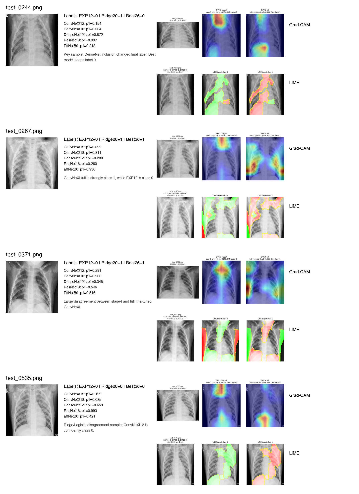

# EXP-30 XAI Comparison Report

이 리포트는 disagreement 샘플에 대해 원본 이미지, Grad-CAM, LIME, 모델별 확률을 함께 보기 위한 정리입니다.

주의: Grad-CAM과 LIME은 모델 판단에 영향을 준 영역을 시각화하는 도구이며, 실제 병변 위치를 확정하는 근거가 아닙니다.

## Summary Table

| file_name | exp12_label | exp20_ridge_label | exp26_best_label | ResNet18_prob1 | DenseNet121_prob1 | EffNetB0_prob1 | ConvNeXt12_prob1 | ConvNeXt18_prob1 |
| --- | --- | --- | --- | --- | --- | --- | --- | --- |
| test_0244.png | 0 | 1 | 0 | 0.9972 | 0.8717 | 0.2184 | 0.154 | 0.3639 |
| test_0267.png | 0 | 1 | 1 | 0.26 | 0.2797 | 0.9304 | 0.3922 | 0.8109 |
| test_0371.png | 0 | 1 | 1 | 0.5462 | 0.3449 | 0.5159 | 0.2915 | 0.9655 |
| test_0535.png | 0 | 0 | 0 | 0.9934 | 0.6525 | 0.4207 | 0.1289 | 0.0847 |

## Key Observations

- `test_0244.png`: EXP-20 Ridge는 1, EXP-26 best는 0으로 판단했고, EXP-26 제출에서 점수가 상승했다. 공개 leaderboard 기준으로는 0 판단이 더 적절했을 가능성이 높다.
- `test_0267.png`, `test_0371.png`: EXP-12 ConvNeXt는 0 쪽이지만 EXP-18 full fine-tuning은 1 쪽으로 강하게 이동했다. full fine-tuning이 일부 샘플에서 양성 방향 신호를 크게 키운 것으로 보인다.
- `test_0535.png`: ConvNeXt 계열은 0에 가깝지만 stacking 모델 간 판단 차이가 있었던 샘플이다.

## Image Panel

## Generated Files

- `xai_comparison_panel.png`
- `xai_comparison_summary.csv`
- `gradcam_convnext_disagreement_comparison.png`
- `lime_convnext_disagreement_comparison.png`